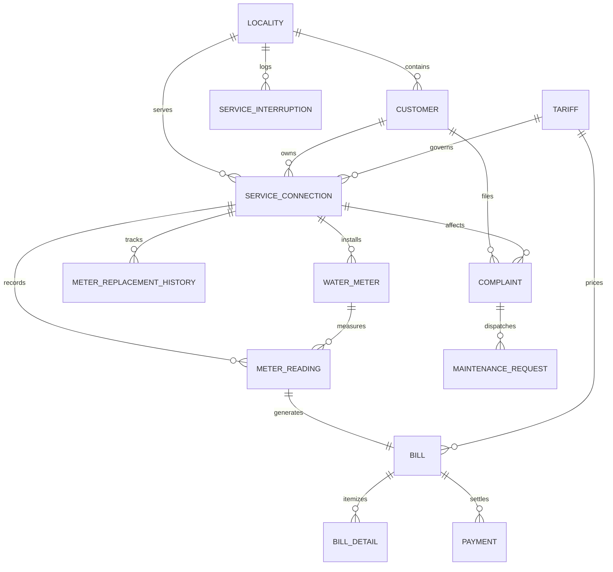

# Water Supply & Utility Billing Management System (`WATER-CAD`)

> **Academic DBMS Project (Project 13)**  
> **Student:** Nirvaid Jain (`TCA2573025`)  
> **Course:** IBD312 — Basics Information Management (B.Tech Semester-III)  
> **Stack:** MySQL 8.0 (InnoDB) · Python · Streamlit · Docker  

---

## Overview

The **Water Supply & Utility Billing Management System** is a relational database and interactive web application designed for a municipal or community water utility provider. It centralizes customer registration, water service connections, physical meter tracking and replacements, monthly meter readings, tariff-based billing, late-payment penalties, payment and refund reconciliation, leakage complaints, maintenance work orders, and service interruption logs.

The database is engineered strictly within the **IBD312 (Basics Information Management)** syllabus—relying on normalized relational design, integrity constraints, B-Tree indexes, views, triggers, stored procedures, transactions, joins, aggregate grouping, `UNION`, and subqueries—paired with a minimalist black-and-white **WATER-CAD** dispatch web interface built in Streamlit.

---

## Key Benefits

- **Zero Duplicate Bills or Inconsistent Ledgers:** Enforced at the database level via `UNIQUE (connection_id, billing_month)` and `UNIQUE (reading_id)` constraints, paired with row-level locking (`FOR UPDATE`) inside transactional stored procedures.
- **Atomic Meter-Reading Correction & Auto-Refunds:** When a misread meter is corrected after payment, `sp_correct_reading_and_recalculate_bill` updates the existing bill in place, posts an exact `CORRECTION_ADJUSTMENT` delta in `BILL_DETAIL`, issues an automatic `REFUND` entry in `PAYMENT` if overpaid, and logs the full trail in `AUDIT_LOG`—rolling back cleanly on any error.
- **Automated Audit Trail & Validation:** Six MySQL triggers automatically compute `units_consumed`, block invalid meter readings or identical meter replacements, and record every payment, refund, reading correction, and complaint status update in `AUDIT_LOG`.
- **Early Leakage & Anomaly Detection:** A correlated SQL subquery flags any monthly reading exceeding **1.5×** the average consumption for its customer category (`DOMESTIC`, `COMMERCIAL`, `INDUSTRIAL`), helping operators spot underground leaks early.
- **Single-Screen Operational Visibility:** The `WATER-CAD` Streamlit interface brings live KPIs, active leakage incidents, high-consumption alerts, overdue accounts, service interruptions, locality revenue, and the live audit stream onto one screen.
- **Flexible Deployment:** Runs locally against MySQL Workbench, launches in one command via Docker Compose, or deploys free on Streamlit Community Cloud with a cloud MySQL host.

---

## IBD312 Syllabus Coverage

| Syllabus Unit / CO | Topics Covered | Implementation in `water_billing_system.sql` |
| :--- | :--- | :--- |
| **Unit 1** | Relational Databases, Data Modeling, Tables, Relational Concepts | 14 normalized (3NF) InnoDB tables in `water_billing_db` |
| **Unit 2** | Simple SQL, Joins, Scalar & Aggregate Functions, `GROUP BY`/`HAVING`, `UNION`, Subqueries | Overdue days (`DATEDIFF`, `UPPER`, `ROUND`), multi-table `INNER`/`LEFT JOIN`s, locality/tariff revenue reports, `UNION ALL` financial ledger, correlated subquery for high-consumption alerts |
| **Unit 3 & CO3** | ER Model, Integrity Rules, Indexes, Views | `PRIMARY KEY`, `FOREIGN KEY`, `UNIQUE`, `NOT NULL`, `CHECK`, `DEFAULT` constraints; 11 B-Tree indexes; 4 reporting views |
| **Unit 4 & CO3** | Physical Implementation, Maintaining Data, Triggers, Transactions, Stored Procedures | 6 `BEFORE`/`AFTER` triggers, 3 transactional stored procedures (`START TRANSACTION`, `FOR UPDATE`, `COMMIT`, `ROLLBACK`), full `AUDIT_LOG` trail |

---

## Database Architecture

### Entity-Relationship Overview



### Core Database Objects

| Object Type | Count | Names |
| :--- | :---: | :--- |
| **Tables** | 14 | `LOCALITY`, `CUSTOMER`, `TARIFF`, `SERVICE_CONNECTION`, `WATER_METER`, `METER_REPLACEMENT_HISTORY`, `METER_READING`, `BILL`, `BILL_DETAIL`, `PAYMENT`, `COMPLAINT`, `MAINTENANCE_REQUEST`, `SERVICE_INTERRUPTION`, `AUDIT_LOG` |
| **Views** | 4 | `vw_customer_connections`, `vw_outstanding_bills`, `vw_locality_consumption_revenue`, `vw_active_maintenance_complaints` |
| **Stored Procedures** | 3 | `sp_generate_monthly_bill`, `sp_record_payment`, `sp_correct_reading_and_recalculate_bill` |
| **Triggers** | 6 | `trg_before_meter_replacement_insert`, `trg_before_meter_reading_insert`, `trg_before_meter_reading_update`, `trg_after_meter_reading_update`, `trg_after_payment_insert`, `trg_after_complaint_update` |
| **Indexes** | 11 | Foreign-key, billing-month, status/due-date, complaint, interruption, and audit-log B-Tree indexes |

---

## Screenshots

> **Note:** Save your screenshots inside a `screenshots/` folder in this repository using the filenames below so GitHub renders them automatically.

### Database (MySQL Workbench)

**1. Database Schema & Successful Script Execution**  

*All 14 tables, 4 views, 3 stored procedures, and 6 triggers created cleanly in MySQL 8.0 with zero errors.*

**2. Analytical Reports & High-Consumption Subquery Output**  

*Locality-wise consumption/revenue report and Unit-2 subquery flagging anomalous usage (`> 1.5x` category average).*

**3. Atomic Billing Correction & Audit Trail Reconciliation**  

*Verification of Bill #7 recalculation (`SUM(BILL_DETAIL) = BILL.total_amount`, auto-refund posted in `PAYMENT`, and logged in `AUDIT_LOG`).*

### Web Application (`WATER-CAD` — Streamlit)

**1. Command Center Dashboard**  

*Single-screen monochrome dispatch view displaying live KPIs, active incidents, high-consumption anomalies, overdue bills, service interruptions, zone revenue, and live audit stream.*

**2. Meter Readings, Bill Generation & Atomic Correction**  

*Interactive forms calling `sp_generate_monthly_bill` and `sp_correct_reading_and_recalculate_bill` directly against MySQL.*

**3. Payments, Complaints & Table Explorer**  

*Payment posting via `sp_record_payment`, complaint status tracking, CSV export, and live database table inspection.*

---

## How to Run

### Option 1: Locally with MySQL Workbench
1. Open **MySQL Workbench**, connect to your local server, and run `sql/water_billing_system.sql` (`Ctrl + Shift + Enter`).
2. Copy `.env.example` to `.env` and add your MySQL password:
   ```env
   DB_HOST=127.0.0.1
   DB_PORT=3306
   DB_USER=root
   DB_PASSWORD=your_mysql_password
   DB_NAME=water_billing_db
   ```
3. Install dependencies and start the web app:
   ```bash
   pip install -r requirements.txt
   streamlit run app.py
   ```
4. Open `http://localhost:8501` in your browser.

### Option 2: One-Command Setup with Docker Compose
```bash
docker compose up --build
```
Docker automatically starts MySQL 8.0, imports `sql/water_billing_system.sql`, and launches the app at `http://localhost:8501`. *(If local MySQL already uses port `3306`, change `"3306:3306"` to `"3307:3306"` in `docker-compose.yml`.)*

---

## Project Structure

```text
water_billing_app/
├── .streamlit/
│   └── config.toml                # Monochrome black-and-white theme
├── sql/
│   └── water_billing_system.sql   # Complete IBD312 MySQL 8.0 database script
├── screenshots/                   # Place MySQL Workbench & Web App PNGs here
├── app.py                         # WATER-CAD Streamlit web application
├── db.py                          # MySQL connection & query helper module
├── requirements.txt               # Python dependencies
├── Dockerfile                     # Container build definition
├── docker-compose.yml             # MySQL 8.0 + Streamlit multi-container setup
├── .env.example                   # Environment variable template
└── instructions.md                # Project documentation
```

---

## Future Enhancements

- Role-based login separating **Admin**, **Field Meter Reader**, and **Customer Portal** views.
- Automated PDF bill generation and email/SMS due-date reminders.
- Multi-slab progressive domestic tariffs and IoT smart-meter reading ingestion.
